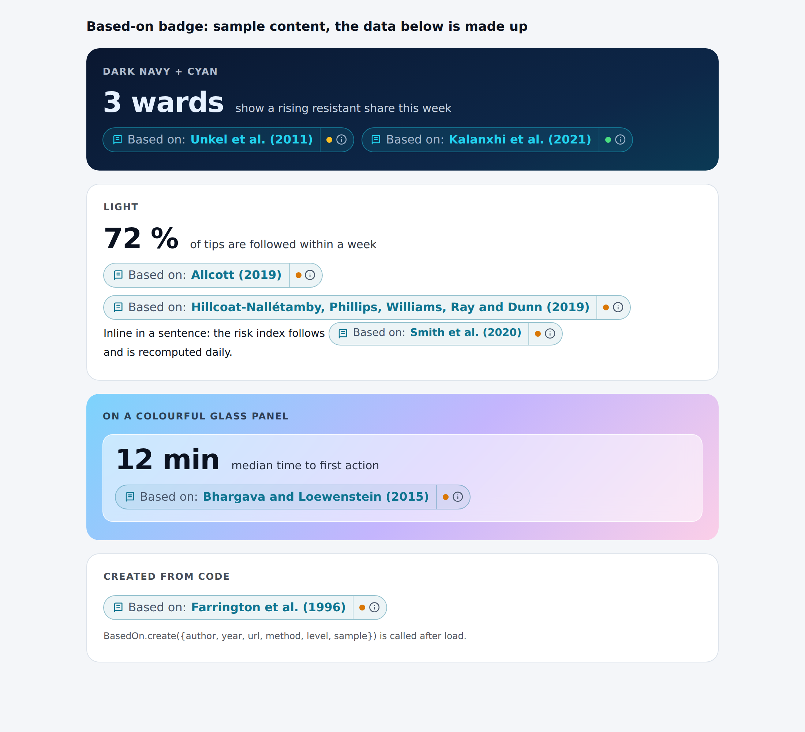

# research-grounding

Give it a hackathon (or any product) brief. About 15 minutes later you have 5-10 well-cited papers, ranked, with one
method card per paper and a small "Based on: Author (Year)" badge you can put next to the number your app shows.
The goal is simple: **one published method, built properly, labelled honestly**, instead of ten ad-hoc heuristics.

- **Finds** papers through [OpenAlex](https://openalex.org) (keyword and semantic search) and
  [Semantic Scholar](https://www.semanticscholar.org). Free public APIs, no key required. Open-access links fall back to
  PubMed Central and arXiv when Semantic Scholar has no PDF link.
- **Ranks** them by rank fusion over several queries, phrase coverage of the brief, semantic similarity and citations.
  It learns the scholars' vocabulary from the first results (pseudo-relevance feedback) and runs a second pass.
- **Writes method cards**: citation, abstract sentences copied (not paraphrased), what is measured, which inputs a team
  would need, limits, and a ready-to-paste pitch line. Nothing in a card is invented; every sentence is either metadata,
  an extract of the abstract, or labelled as a draft.
- **Renders a badge** (plain CSS + JS, no dependencies, dark and light themes) that says "implements" until you have run
  the method on real data and "validated on ..." only after, with your own sample text.

Python 3.10+, standard library only (`requests` is used if installed). The optional LLM steps need an Anthropic key and
are never required.

## Quickstart (3 commands)

```bash
git clone https://github.com/oroomi/research-grounding && cd research-grounding
python3 -m rg.find --brief examples/ocean-tech-startup-funding/brief.txt --keywords "startup funding prediction" "venture capital success"
python3 -m rg.badge cards/results.json --rank 2 --method "One line: what WE compute from this paper"
```

Command 2 prints the query plan first, then searches (about a minute), and writes `cards/INDEX.md` (start here) plus one
`cards/<author-year-title>.md` per paper and `cards/results.json`. Command 3 prints the badge HTML for paper number 2;
include `badge/based-on.css` and `badge/based-on.js` on the page. Put your own brief in a text file and use
`--brief your-brief.txt`.

Read the plan before you read the results. If the automatic subject is wrong or too generic, add 2-4 scholarly terms the
brief does not contain with `--keywords "term one" "term two"`; cached queries are free, so re-running is cheap. On a
vague consumer brief this step decides the quality of the whole result.

Useful options: `--top 10` (number of cards), `--years 2010-2026`, `--out cards`, `--dry-run` (print the plan, no
network), `--no-semantic-scholar`, `--no-prf`, `--no-llm`, `--refresh` (ignore the cache), `--any-language`.

## What you get

`examples/` holds real runs against the live public APIs (no LLM key, 18-21 October 2026, rendered with the current code):

| Brief | Folder |
|---|---|
| Predict which early-stage ocean-tech startups will raise funding | [`examples/ocean-tech-startup-funding/`](examples/ocean-tech-startup-funding/cards/INDEX.md) (with a rendered [badge page](examples/ocean-tech-startup-funding/badge.html)) |
| Ward-level antibiotic resistance trend detection | [`examples/tyks-mylab-ward-amr/`](examples/tyks-mylab-ward-amr/cards/INDEX.md) |
| Prevention nudges at the moment of a home move | [`examples/if-insurance-home-move/`](examples/if-insurance-home-move/cards/INDEX.md), and the same brief with `--keywords`: [`cards-with-keywords/`](examples/if-insurance-home-move/cards-with-keywords/INDEX.md) |

The three briefs are short reconstructions we wrote in the style of partner challenges (the ocean-tech one is invented
outright). They are not the official wording of any organisation, and the organisations they mention are not affiliated
with this project.
The IF example is deliberately kept twice: the automatic plan alone put about half the results off topic, the
`--keywords` run fixed it.



## From papers to a build (the honesty ladder)

1. Open `cards/INDEX.md`, skim title, year, citations and method terms, open the top 3-4 cards.
2. Pick **one** method by the data you actually have: can every input in the card's "Signals" section be mapped to a column
   you have? Does it give one number or flag a judge sees in a glance? Can you test it before the demo?
   Prefer an older, simpler, well-cited method over a fancy one; use reviews for the landscape, implement from a primary paper.
3. Read that paper's methods (the card only has the abstract) and note what differs between its data and yours.
4. Build it as a visible signal and add the badge next to it.

| State | Badge `data-level` | Words you may use |
|---|---|---|
| coded, not run on partner data | `implements` | "Implements the method of Author (Year). Not yet validated on our data." |
| run on a sample you have | `validated` + `data-sample` | "Validated on <sample, N>: <what we measured>." (only numbers you computed) |
| numbers from the paper | never yours | "The paper reports X" (attributed, with its sample) |

The badge refuses to say "validated" without a sample text. Never quote a number from a paper as your own result.

## How to cite

**The papers you use.** Every card has a `Citation` block (APA-style, with the DOI link) and a `Badge text`. Copy the
citation into your README / DISCLOSURE / slides, say which honesty level applies, and check the year against the DOI page
(OpenAlex gives the online year; the journal's print year can differ by one). Cite only papers that appear in the finder
output, so every citation resolves. The card's "Ready-to-paste pitch line" is a good start:

> Our <signal name> implements the method of Author et al. (Year), https://doi.org/... It has not been validated on the
> partner's data yet.

**This kit.** If you want to acknowledge it: The Mishakin Group (2026). *research-grounding* (version 0.1.0).
https://github.com/oroomi/research-grounding. GitHub's "Cite this repository" button uses [`CITATION.cff`](CITATION.cff).

## Configuration (all optional)

| Variable | Effect |
|---|---|
| `RG_MAILTO` | your own email, sent to OpenAlex as the "polite pool" `mailto` parameter |
| `RG_OPENALEX_KEY` | free OpenAlex API key (about 10x the anonymous daily budget) |
| `S2_API_KEY` | Semantic Scholar API key; without it the shared anonymous pool often answers 429 |
| `ANTHROPIC_API_KEY` | enables two extra steps: better search queries and a drafted "signals" section (labelled draft in the card). Sent only to api.anthropic.com, never logged or cached. `RG_MODEL` overrides the model |

API keys and the mailto address are never written to the cache or to the output files. Raw API responses are cached in
`.cache/` (re-runs are free); `--refresh` ignores it.

## Limits (read before you rely on it)

- **Rate limits.** Anonymous OpenAlex use has a small daily budget (the run prints what is left; a free key gives about
  10x) and about 8 full runs per day per IP is what we saw. Semantic Scholar's anonymous pool is shared and often answers
  429: the finder retries, then switches Semantic Scholar off for that run and carries on with OpenAlex only. Both facts
  are written into `INDEX.md` as warnings, so you always know which sources answered.
- **Coverage.** Only records that have an abstract are searched (`has_abstract:true`); paywalled papers without an
  abstract in OpenAlex or Semantic Scholar are invisible. English papers and years 2010 to now by default. Retracted
  works are dropped. Citation counts differ between the two sources and lag for recent papers.
- **Relevance is a heuristic.** On a specific brief about 6 to 8 of 10 results are on topic, on a vague consumer brief
  fewer; `--keywords` helps most. It finds candidates, it does not judge fit.
- **Cards are extracts, not understanding.** They copy sentences from the abstract and match method words from a lexicon.
  No full text is read. The paper's population, setting and definitions may differ from your data.
- **Not a fact-checker.** A highly cited paper can still be wrong or not transfer. The first rule is: read the abstract of
  your top two, then the methods of the one you pick.
- Results from live APIs change from day to day; the `examples/` are snapshots, not benchmarks.

## Tests

```bash
python3 -m pytest -q
```

Offline: the APIs are replaced by recorded fixtures (real, trimmed OpenAlex and Semantic Scholar responses; contact
addresses removed) and the LLM calls are mocked. The badge tests drive a headless Chromium through Playwright and skip
themselves if it is not installed.

## Layout

```
rg/find.py       CLI: plan -> search -> second pass -> merge -> rank -> cards
rg/queries.py    brief -> search queries (keyword extraction, task facets); rg/prf.py: second-pass vocabulary
rg/sources.py    OpenAlex and Semantic Scholar clients; rg/http.py: cache, retry, secrets handling
rg/rank.py       merge by DOI/title, rank fusion, coverage, reviews cap
rg/cards.py      method cards and INDEX.md; rg/llm.py: optional LLM steps; rg/badge.py: badge HTML helper
badge/           based-on.css, based-on.js, snippets and a demo page
examples/        real runs on three briefs
```

## Licence

MIT, Copyright (c) 2026 The Mishakin Group. See [LICENSE](LICENSE). Paper titles, abstracts and metadata in the examples
and test fixtures belong to their authors and publishers and are quoted as short snippets with their DOI for citation;
the kit does not redistribute full texts.
